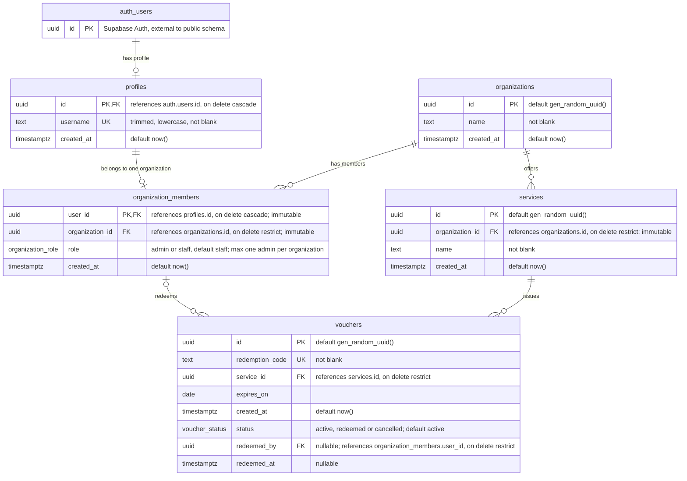

# Entity Relationship Diagram

Source: `supabase/migrations/20261029211310_initial_data_layer.sql`

## Enums

| Type | Values |
| --- | --- |
| `public.organization_role` | `admin`, `staff` |
| `public.voucher_status` | `active`, `redeemed`, `cancelled` |

## Business rules not visible in the diagram

- **One organization per user:** `organization_members.user_id` is the primary key, so a profile belongs to at most one organization.
- **One admin per organization:** partial unique index `organization_members_one_admin_per_organization` on `organization_id where role = 'admin'`.
- **Immutable assignments:** triggers block changing `organization_members.user_id` / `organization_id` and `services.organization_id` after insert.
- **Redemption state:** `vouchers_redemption_state_check` requires `redeemed_by` and `redeemed_at` to be set when `status = 'redeemed'` and both to be null for `active` or `cancelled`.
- **Redeemer scope:** trigger `vouchers_validate_redeemer_organization` requires the redeemer to be a member of the organization that owns the voucher's service.

## Read access (RLS)

All tables have RLS enabled. Column-level grants limit which columns each role can select.

| Table | `anon` | `authenticated` |
| --- | --- | --- |
| `profiles` | none | Own profile; admins also see profiles of their organization's members |
| `organization_members` | none | Own membership; admins also see all members of their organization |
| `organizations` | All rows: `id`, `name` | Members of that organization |
| `services` | All rows: `id`, `organization_id`, `name` | Members of the owning organization |
| `vouchers` | All rows: `id`, `status`, `expires_on` | Members of the owning organization: `id`, `service_id`, `status`, `expires_on` |

### Voucher read interfaces

- **`public.organization_vouchers`** (view, `security_invoker = true`): `id`, `service_id`, `status`, `expires_on` for the caller's organization. Staff and admins can both read it, and both can count vouchers by status.
- **`public.get_voucher_redemptions()`** (RPC, admin only): `id`, `service_id`, `redemption_code`, `redeemed_by`, `redeemed_at` for the caller's organization, **redeemed vouchers only**.
  - Codes of active or cancelled vouchers are never returned, not even to admins.
  - Non-admins get an empty result.
  - It is a security invoker wrapper around the security definer `private.voucher_redemptions()`. The definer is needed because `authenticated` has no column grant on the redemption columns.

## Write access

- **`authenticated`**: may update only `profiles.username`, on their own profile (`USING` and `WITH CHECK` on `auth.uid() = id`). The existing constraints keep usernames normalized and unique. No other writes are allowed.
- **`service_role`**: full access to all tables, and bypasses RLS.
- **Voucher redemption**: this will be an Edge Function using the `service_role` client. That function must:
  - take `redeemed_by` from the verified JWT subject, never from the request body (RLS `WITH CHECK` does not apply to `service_role`);
  - verify the code, that the voucher is active and unexpired, and that the caller belongs to the voucher's organization.
- **Trigger as backstop**: `vouchers_validate_redeemer_organization` rejects a redeemer from another organization.
  - Its function is `security invoker` and takes `FOR KEY SHARE` locks, which need `UPDATE` privilege on `services` and `organization_members`. `service_role` has that privilege, so the trigger works for the Edge Function; `data_layer_test.sql` covers this.
  - If `authenticated` is ever given direct voucher `UPDATE`, make that function `security definer` or drop the locks first.
- **Planned**: organization admins update their members' `left_at` date (column not added yet).
