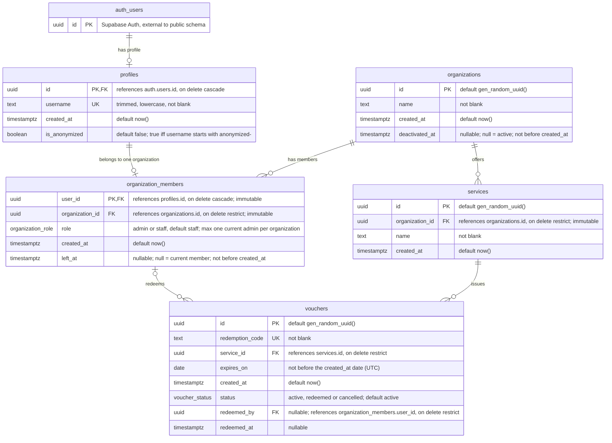

# Entity Relationship Diagram

Sources:

- `supabase/migrations/20261029211310_initial_data_layer.sql`
- `supabase/migrations/20261102223932_soft_deletion.sql`

## Enums

| Type | Values |
| --- | --- |
| `public.organization_role` | `admin`, `staff` |
| `public.voucher_status` | `active`, `redeemed`, `cancelled` |
