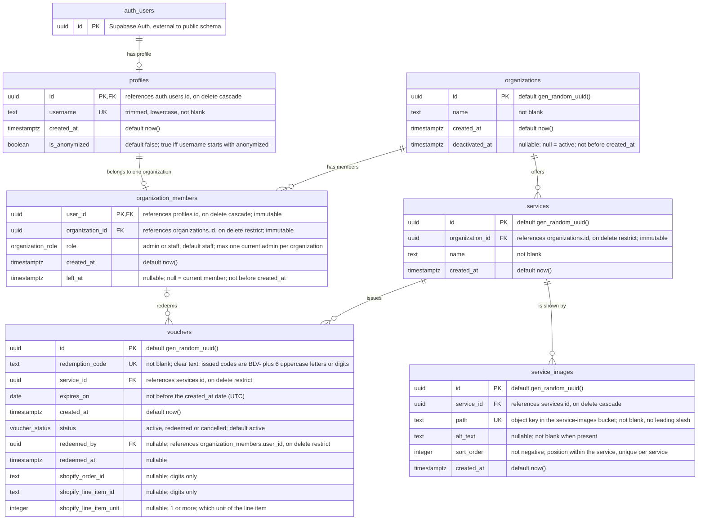

# Entity Relationship Diagram

Sources:

- `supabase/migrations/20261029211310_initial_data_layer.sql`
- `supabase/migrations/20261102223932_soft_deletion.sql`
- `supabase/migrations/20261112115255_service_images.sql`
- `supabase/migrations/20261113180000_voucher_issuance.sql`

`service_images.path` points at an object in the public `service-images` Storage bucket. There is no foreign key into `storage.objects`, so deleting a row (directly or by deleting its service) leaves the file in the bucket; see `docs/adr/0003-store-service-images-in-a-public-bucket.md`.

The three `vouchers.shopify_*` columns say which sale a voucher came from. They are all set or all null, and unique together, so the `issue-voucher` Edge Function can be called again for the same sale without creating a second voucher. Each issued voucher has a QR code at `<voucher_id>.png` in the private `generated-qrs` Storage bucket; see `docs/adr/0004-issue-vouchers-through-a-shared-secret-webhook.md`.

## Enums

| Type | Values |
| --- | --- |
| `public.organization_role` | `admin`, `staff` |
| `public.voucher_status` | `active`, `redeemed`, `cancelled` |
